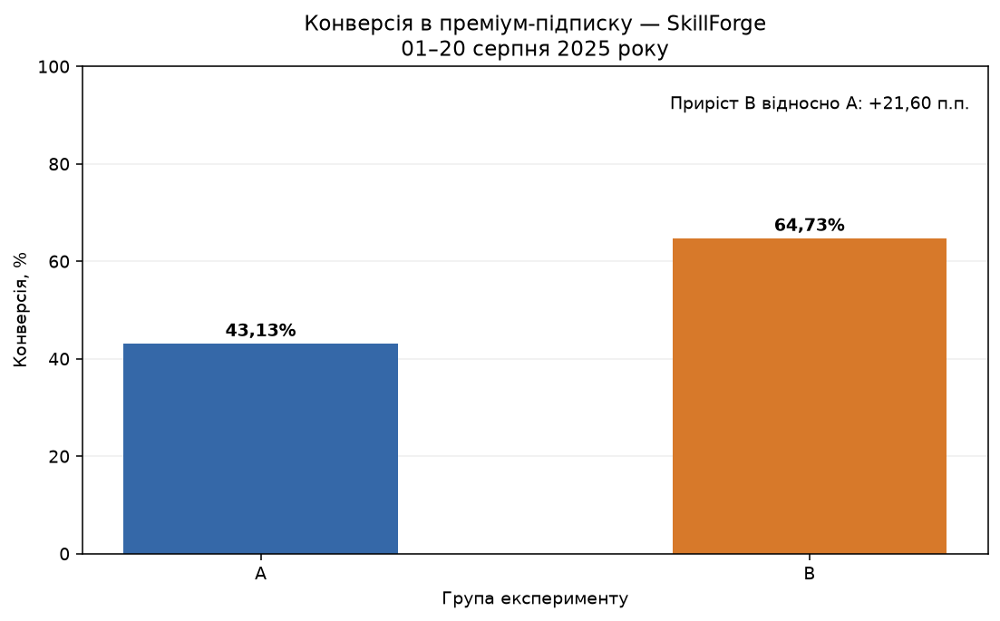
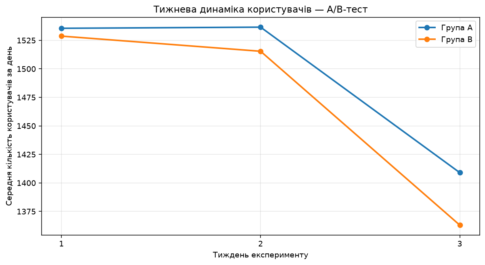
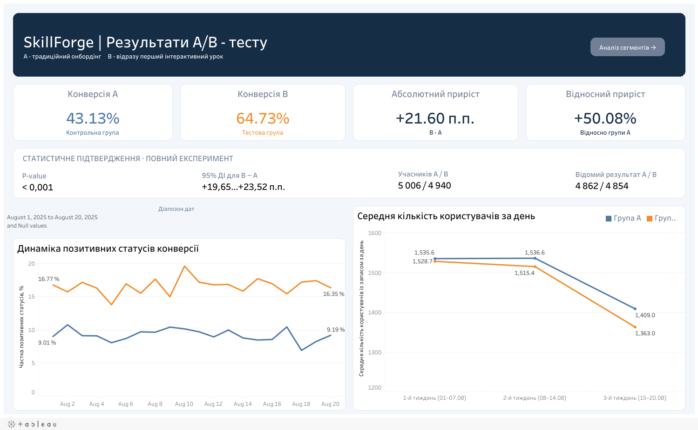

# SkillForge — A/B-тест нового онбордингу

Чи підвищує перехід одразу до інтерактивного уроку конверсію в преміум-підписку? Аналіз навчального експерименту за **01–20 серпня 2025 року**: перевірка даних, PostgreSQL, статистичний тест, сегменти та Tableau.

**Вебзвіти:** [1. Очищення даних](https://djon-sql.github.io/skillforge-ab-test-analysis/eda.html) · [2. A/B-аналіз](https://djon-sql.github.io/skillforge-ab-test-analysis/) · [Tableau Public](https://public.tableau.com/app/profile/djon.fa/viz/SkillForce/01AB-)

**Ноутбуки:** [Очищення даних](SkillForge_Kupriyanov_eda_cleaning.ipynb) · [A/B-аналіз](SkillForge_Kupriyanov_ab_test_analysis.ipynb)

**Інструменти:** Python · Pandas · Matplotlib · Statsmodels · PostgreSQL · Tableau

## Навігація

[Задача](#business-question) · [Результат](#results) · [Методика](#methodology) · [Сегменти](#segments) · [Тижневі тренди](#weekly-trends) · [Рекомендації](#recommendations) · [Обмеження](#limitations) · [Матеріали](#files)

## 1. Задача та контекст

SkillForge — навчальна платформа. Перевіряється новий онбординг **«Миттєве занурення»**:

- **A, контроль:** після реєстрації користувач бачить перелік тем.
- **B, тест:** користувач одразу переходить до першого інтерактивного уроку.

Бізнес-питання — чи варто впроваджувати новий сценарій за результатом конверсії в преміум-підписку. Додатково досліджено конверсію за країнами й пристроями та схожість тижневих коливань використання продукту в A/B.

Це **навчальні змодельовані дані, варіант 42**, а не показники реального бізнесу. Проєкт охоплює весь шлях від сирого Excel до висновків і дашбордів.

## 2. Головний результат

**B має вищу конверсію: 64,73% проти 43,13% у A.** Різниця становить **+21,60 процентного пункта**, або **+50,08% відносно A**.

| Показник | A — контроль | B — тест |
|---|---:|---:|
| Учасники з визначеною групою | 5 006 | 4 940 |
| Відомий підсумковий статус конверсії | 4 862 | 4 854 |
| Підтверджена конверсія | 2 097 | 3 142 |
| Невідомий підсумковий статус | 144 | 86 |
| Конверсія серед відомих статусів | **43,13%** | **64,73%** |

| Перевірка | Результат |
|---|---:|
| Абсолютний приріст B − A | +21,60 п.п. |
| Відносний приріст до A | +50,08% |
| Односторонній z-тест, α = 0,05 | p ≈ 1,69 × 10⁻¹⁰¹ |
| 95% довірчий інтервал різниці, метод Newcombe | [+19,65; +23,52] п.п. |
| Крайні сценарії для невідомих статусів | від +18,84 до +23,45 п.п. |

Основна конверсія розрахована для **9 716 користувачів із визначеною групою та відомим статусом**. У крайніх сценаріях використано всіх 9 946 учасників із визначеною групою; це інший знаменник. Навіть за найгіршого для B розподілу невідомих статусів його перевага зберігається.

[Детальні розрахунки →](https://djon-sql.github.io/skillforge-ab-test-analysis/#conversion)

## 3. Дані та методика

### Підготовка даних

- Перевірено п’ять таблиць: `device`, `country`, `group`, `user`, `daily`.
- Із 61 002 щоденних записів видалено **1 196 повних дублікатів**, потім **60 записів поза періодом**. Залишилося **59 746 записів**.
- **20 негативних `days_on_product`** замінено на пропуски без видалення користувачів.
- **501 невідомий щоденний статус конверсії** збережено; пропуски не прирівнювалися до нуля.
- У PostgreSQL визначено первинні й зовнішні ключі, обмеження значень і два view.

### Визначення метрики

Одиниця основного аналізу — **користувач**, а не щоденний запис. Підсумковий статус за період:

1. `1` — є хоча б один запис `converted = 1`.
2. `NULL` — немає підтвердженої конверсії, але є невідомий щоденний статус або немає жодного щоденного запису.
3. `0` — наявні щоденні статуси відомі та дорівнюють нулю.

**Конверсія = користувачі зі статусом 1 / користувачі з відомим статусом 0 або 1.** У A/B-порівняння не входять 54 користувачі без визначеної групи.

`v_user_conversion` містить один рядок на користувача. `v_daily_agg` — один рядок на дату та групу. Частка щоденних позитивних статусів має інший зміст і знаменник, ніж конверсія користувачів за весь експеримент; її не усереднювали для отримання головного KPI.

Перевірено односторонню гіпотезу **H₁: CR(B) > CR(A)** при α = 0,05. Окремо побудовано двосторонній 95% довірчий інтервал різниці та крайні сценарії для пропусків.

[Перевірки та очищення даних →](https://djon-sql.github.io/skillforge-ab-test-analysis/eda.html#data-quality) · [SQL →](sql/01_schema_and_views.sql)

## 4. Сегменти: пристрої та країни

У всіх основних досліджених сегментах спостережувана конверсія B вища за A.

| Основні пристрої | Приріст B − A |
|---|---:|
| Планшет | +25,33 п.п. |
| Мобільний пристрій | +21,66 п.п. |
| Комп’ютер | +21,32 п.п. |

Серед п’яти основних країн найбільший приріст зафіксовано у **Бразилії — +24,81 п.п.**, найменший — у **Франції — +15,64 п.п.**

**Це описові порівняння.** Відмінності приросту між країнами та пристроями окремо статистично не перевірялися. Для Smartwatch, TV та коду країни `XX` вибірки малі: ці категорії не дозволяють упевнено стверджувати ні наявність, ні відсутність ефекту. Зв’язок сегмента з конверсією не доводить його причинного впливу.

[Сегментний аналіз →](https://djon-sql.github.io/skillforge-ab-test-analysis/#segments) · [Інтерактивні зрізи в Tableau →](https://public.tableau.com/app/profile/djon.fa/viz/SkillForce/01AB-)

## 5. Тижневі закономірності

У перших двох періодах середня щоденна кількість користувачів із записами відносно стабільна; у третьому — нижча в обох групах. A і B мають схожий характер щоденних коливань: **найнижчі значення припадають на неділі, найвищі — на четверги**.

Періоди містять **7, 7 і 6 днів**. У третьому періоді немає четверга, тому склад днів тижня може частково пояснювати нижче середнє. Статистичну рівність трендів не перевіряли. Показник характеризує користувачів із записами `daily`, а не незалежно виміряну залученість чи конверсію.

[Щоденні коливання та пояснення →](https://djon-sql.github.io/skillforge-ab-test-analysis/#weekly-trends)

## 6. Висновок для бізнесу

**Розглядати B як пріоритетний варіант для поетапного впровадження.** Перевага статистично значуща, практично суттєва та зберігається в крайніх сценаріях невідомих статусів.

Перед повним запуском:

1. Перевірити трекінг підписок і причини нерівномірних пропусків у A/B.
2. Контролювати конверсію, утримання та скасування підписок під час поетапного впровадження.
3. Продовжити моніторинг основних країн і пристроїв, уникаючи рішень на основі малих вибірок.

Утримання, скасування та дохід у цьому проєкті **не розраховані** — це показники для контролю наступного запуску. Дані не дають підстав перетворювати приріст конверсії на прогноз доходу.

[Повні висновки та рекомендації →](https://djon-sql.github.io/skillforge-ab-test-analysis/#conclusions)

## 7. Обмеження

- Навчальний датасет і 20-денне вікно обмежують узагальнення на реальний бізнес та довгостроковий ефект.
- Невідомі підсумкові статуси: A — 144, B — 86. Їхній вплив перевірено сценаріями, але самі причини пропусків не встановлені.
- Відсутні групи у 54 користувачів; вони виключені з A/B-порівняння.
- Сегментні відмінності та схожість трендів є описовими; окремих тестів взаємодії чи рівності трендів не проводили.
- Поведінкові механізми, вплив на дохід та довгострокове утримання не доведені цими даними.

## 8. Матеріали проєкту

| Матеріал | Що можна переглянути |
|---|---|
| [Очищення даних — вебверсія](https://djon-sql.github.io/skillforge-ab-test-analysis/eda.html) | HTML-версія першого ноутбука: перевірки якості, очищення, код та збережені результати. Зміст і перехід до A/B-аналізу |
| [A/B-аналіз — вебверсія](https://djon-sql.github.io/skillforge-ab-test-analysis/) | HTML-версія другого ноутбука: розрахунки, таблиці, графіки та висновки. Зміст і перехід до очищення даних |
| [Ноутбук очищення](SkillForge_Kupriyanov_eda_cleaning.ipynb) | Авторський Python-код та збережені узагальнені результати підготовки даних |
| [Ноутбук A/B-аналізу](SkillForge_Kupriyanov_ab_test_analysis.ipynb) | Авторські розрахунки, графіки й узагальнені результати |
| [SQL](sql/01_schema_and_views.sql) | Останній авторський файл `SkillForge_sql(1).sql`: таблиці, обмеження та два аналітичні view |
| [Tableau Public](https://public.tableau.com/app/profile/djon.fa/viz/SkillForce/01AB-) | Два інтерактивні дашборди |

Вихідні користувацькі записи не включені до репозиторію. Для перегляду доступні код, графіки та збережені узагальнені результати; повний повторний запуск потребує вихідного навчального набору.

[Повернутися до навігації ↑](#navigation)

---

**Дмитро Купріянов** · Junior Data Analyst · [GitHub](https://github.com/djon-sql) · [Tableau Public](https://public.tableau.com/app/profile/djon.fa/vizzes)
